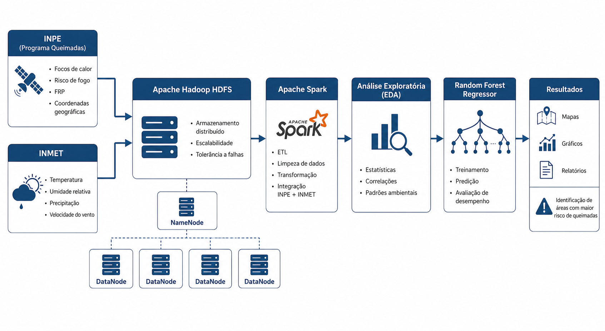
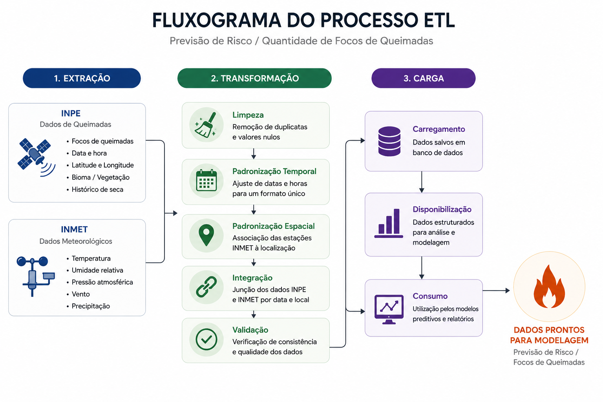

# Monitoramento Ambiental em Áreas de Desmatamento do Pantanal com Apache Spark

Projeto desenvolvido na disciplina de Ciência de Dados com o objetivo de integrar dados geoespaciais e meteorológicos para prever o risco de queimadas no Pantanal Sul-Mato-Grossense utilizando técnicas de Big Data e Machine Learning.

---

## Arquitetura da Solução

<p align="center">
  
</p>

*Figura 1 – Arquitetura proposta para armazenamento e processamento dos dados ambientais.*

---

## Processo ETL

<p align="center">
  
</p>

*Figura 2 – Processo ETL utilizado para integração das bases de dados.*

---

## Objetivo

O projeto busca responder à seguinte pergunta de pesquisa:

> **A combinação de dados geoespaciais do INPE com dados meteorológicos do INMET melhora a capacidade de prever a ocorrência e a intensidade de queimadas quando comparada ao uso isolado de cada uma dessas fontes de dados?**

Para responder essa questão foram comparados três cenários utilizando o algoritmo **Random Forest Regressor**:

- Modelo utilizando apenas dados do INPE;
- Modelo utilizando apenas dados do INMET;
- Modelo utilizando a integração entre INPE e INMET.

---

# Tecnologias Utilizadas

- Python
- Google Colab
- Apache Hadoop
- Apache Spark (PySpark)
- Pandas
- NumPy
- Scikit-Learn
- Matplotlib
- Seaborn

---

# Bases de Dados

## INPE – Programa Queimadas

Dados geoespaciais contendo:

- Focos de calor;
- Risco de fogo;
- Fire Radiative Power (FRP);
- Latitude e Longitude;
- Dias sem chuva;
- Precipitação.

---

## INMET – Estações Meteorológicas

Dados meteorológicos contendo:

- Temperatura do ar;
- Umidade relativa;
- Precipitação;
- Velocidade do vento;
- Data e Hora.

---

# Fluxo do Projeto

```text
INPE + INMET
        │
        ▼
Carregamento dos Dados
        │
        ▼
Tratamento e Limpeza
        │
        ▼
Integração das Bases
        │
        ▼
Análise Exploratória (EDA)
        │
        ▼
Random Forest Regressor
        │
        ▼
Comparação dos Modelos
        │
        ▼
Resultados
```

---

# Organização do Notebook

O notebook foi estruturado nas seguintes etapas:

```text
1. Introdução

2. Base de Dados

3. Ambiente de Processamento

4. Processo ETL

5. Preparação dos Dados

6. Análise Exploratória dos Dados (EDA)

7. Modelagem Preditiva

8. Comparação dos Resultados

9. Conclusão
```

---

# Estrutura do Repositório

```text
📁 notebook/
    Monitoramento_Queimadas.ipynb

📁 imagens/
    arquitetura.png
    etl.png
    dicionario_INPE.png
    ...

📄 README
```

---

# Como Executar

O projeto foi desenvolvido utilizando o **Google Colab**.

1. Abra o notebook.
2. Execute todas as células em sequência.
3. Os datasets serão carregados automaticamente durante a execução.

> Os arquivos de dados estão armazenados em um repositório separado e são acessados automaticamente pelo notebook.

---

# Resultados

| Modelo | R² | MAE |
|---------|------:|------:|
| Apenas INPE | 0.8303 | 5.25 |
| Apenas INMET | 0.0140 | 31.93 |
| **INPE + INMET** | **0.8691** | **4.68** |

O modelo construído a partir da integração das bases apresentou o melhor desempenho, demonstrando que a combinação entre informações geoespaciais e meteorológicas melhora a capacidade preditiva quando comparada ao uso isolado de cada fonte de dados.

---

# Principais Conclusões

- Os dados do INPE apresentaram elevado poder preditivo quando utilizados isoladamente.
- Os dados do INMET, sozinhos, apresentaram baixo desempenho.
- A integração entre INPE e INMET produziu o modelo mais preciso.
- A localização geográfica foi um dos fatores mais importantes para a previsão do risco de incêndio.
- A integração entre dados geoespaciais e meteorológicos melhora a qualidade das previsões.

---

# Autores

- Odair F.
- Carlos B.
- Lucas Jr.
- Bruna B.

Curso de Sistemas de Informação

Universidade Federal de Mato Grosso do Sul (UFMS)

---